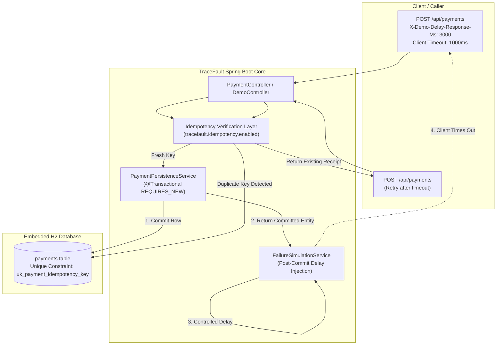

# TraceFault — Duplicate Payment Detection and Recovery

[]()
[]()
[]()
[]()
[]()

TraceFault is a production-inspired, lightweight software engineering and reliability demonstration prototype designed to reproduce, investigate, correct, and verify a critical distributed-system reliability failure:

> Duplicate payment processing caused by a successful payment operation followed by a lost or delayed HTTP response and a subsequent client retry.

The project is deliberately scoped and engineered to be understood, executed, inspected, and demonstrated end-to-end within a 15–20 minute recording.

---

## 1. System Architecture

TraceFault follows a clean layered architecture with strict separation of transaction boundaries and failure simulation:



### Component Breakdown

| Component | Responsibility |
| :--- | :--- |
| `PaymentController` | Exposes REST endpoints for payment creation, transaction lookups, and statistics with OpenAPI annotations. |
| `PaymentService` | Orchestrates payment flow, idempotency validation, payload mismatch detection, and concurrency defense. |
| `PaymentPersistenceService` | Dedicated transactional boundary (`@Transactional(propagation = Propagation.REQUIRES_NEW)`) ensuring rows are committed to H2 before any response delay. |
| `FailureSimulationService` | Injects post-commit delays via `X-Demo-Delay-Response-Ms` header, reproducing client socket timeouts. |
| `DatabaseIndexManager` | Dynamically enforces or relaxes the database unique index `uk_payment_idempotency_key` based on configured mode. |
| `GlobalExceptionHandler` | Formats RFC 7807-style errors for HTTP 400 (missing key), 409 (payload conflict), and 404 (not found). |
| `OpenApiConfig` | Configures Swagger OpenAPI 3.0 metadata, tags, and documentation descriptors. |

---

## 2. Technology Stack

- Java: 21 (tested up to OpenJDK 25 runtime)
- Framework: Spring Boot 3.5.x
- API Docs: SpringDoc OpenAPI 2.8.5 (Swagger UI 5.x)
- Build Tool: Apache Maven with Maven Wrapper (`mvnw`, `mvnw.cmd`)
- Persistence: Spring Data JPA / Hibernate 6.6
- Database: Embedded H2 Database (in-memory mode)
- Validation: Jakarta Bean Validation (Hibernate Validator)
- Testing: JUnit 5, Spring Boot Test, AssertJ, Mockito

No external dependencies, Docker containers, Redis, Kafka, or cloud services are required.

---

## 3. Prerequisites & Installation

### Prerequisites
- JDK 21 or higher installed (`java -version`)
- Git

### Build the Project
Clone the repository and build using the included Maven Wrapper:

Windows PowerShell:
```powershell
.\mvnw.cmd clean package -DskipTests
```

macOS / Linux:
```bash
./mvnw clean package -DskipTests
```

---

## 4. Running the Application

### Option A: Vulnerable Demonstration Mode (Default)
In this mode (`tracefault.idempotency.enabled=false`), duplicate request protection is disabled to demonstrate the failure:

Windows PowerShell:
```powershell
.\mvnw.cmd spring-boot:run
```

macOS / Linux:
```bash
./mvnw spring-boot:run
```

### Option B: Corrected Mode via Configuration Flag
You can also launch directly in protected mode:

```bash
java -jar target/tracefault-1.0.0-SNAPSHOT.jar --tracefault.idempotency.enabled=true
```

### Swagger OpenAPI Documentation & Interactive UI
- Swagger UI: `http://localhost:8080/swagger-ui.html` (redirects to `/swagger-ui/index.html`)
- OpenAPI Spec: `http://localhost:8080/v3/api-docs`

### H2 Web Console
- URL: `http://localhost:8080/h2-console`
- JDBC URL: `jdbc:h2:mem:tracefaultdb`
- User: `sa`
- Password: *(leave blank)*

---

## 5. REST API Documentation

### A. Process Payment
`POST /api/payments`

Headers:
- `Content-Type: application/json`
- `Idempotency-Key: <unique-identifier>` *(required when protection is enabled)*
- `X-Demo-Delay-Response-Ms: <milliseconds>` *(optional failure simulation delay)*

Request Payload:
```json
{
  "orderId": "ORDER-101",
  "amount": 1000.00,
  "currency": "INR"
}
```

Response (200 OK):
```json
{
  "id": 1,
  "orderId": "ORDER-101",
  "amount": 1000.00,
  "currency": "INR",
  "idempotencyKey": "KEY-DEMO-001",
  "paymentStatus": "SUCCESS",
  "createdAt": "2026-10-30T12:56:33.598Z",
  "updatedAt": "2026-10-30T12:56:33.598Z",
  "duplicate": false
}
```

### B. Get All Payments
`GET /api/payments`  
Returns array of all persisted payment transactions.

### C. Get Payment by Idempotency Key
`GET /api/payments/by-key/{key}`  
Returns transaction associated with the key (or HTTP 404 if not found).

### D. Get Payment Statistics
`GET /api/payments/statistics`

Response:
```json
{
  "totalRecords": 2,
  "successfulPayments": 2,
  "totalProcessedAmount": 2000.00
}
```

### E. Reset Demonstration State
`POST /api/demo/reset` *(non-production profile only)*  
Clears all synthetic payment records and resets the database schema index.

### F. Dynamic Mode Toggle
`POST /api/demo/mode?idempotencyEnabled=true|false`  
Switches idempotency protection live without restarting the application.

---

## 6. Reproducing the Reliability Problem (Step-by-Step)

### Step 1: Reset Demonstration State
```bash
curl.exe -s -X POST http://localhost:8080/api/demo/reset
```

### Step 2: First Payment with Post-Commit Delay & Client Timeout
Send request with a 3000ms server delay, but configure the client to time out after 1000ms:

```powershell
curl.exe --max-time 1 -s -X POST http://localhost:8080/api/payments `
  -H "Content-Type: application/json" `
  -H "Idempotency-Key: KEY-DEMO-001" `
  -H "X-Demo-Delay-Response-Ms: 3000" `
  -d '{"orderId":"ORDER-101","amount":1000.00,"currency":"INR"}'
```

### Step 3: Wait for Server Delay to Finish
Wait 3 seconds for the server-side thread to complete the simulated delay.

### Step 4: Client Retries Identical Payment
Because the client received a timeout error, it retries the payment without the delay header:

```powershell
curl.exe -s -X POST http://localhost:8080/api/payments `
  -H "Content-Type: application/json" `
  -H "Idempotency-Key: KEY-DEMO-001" `
  -d '{"orderId":"ORDER-101","amount":1000.00,"currency":"INR"}'
```

### Step 5: Verify the Duplicate Debit (Vulnerability Proved)
```powershell
curl.exe -s http://localhost:8080/api/payments/statistics
```
Output:
```json
{"totalRecords":2,"successfulPayments":2,"totalProcessedAmount":2000.00}
```

---

## 7. Verifying the Correction (Idempotency Protection)

### Step 6: Enable Idempotency Protection
```powershell
curl.exe -s -X POST "http://localhost:8080/api/demo/mode?idempotencyEnabled=true"
curl.exe -s -X POST http://localhost:8080/api/demo/reset
```

### Step 7: Repeat the Exact Same Experiment
First payment with delay:
```powershell
curl.exe --max-time 1 -s -X POST http://localhost:8080/api/payments `
  -H "Content-Type: application/json" `
  -H "Idempotency-Key: KEY-DEMO-002" `
  -H "X-Demo-Delay-Response-Ms: 3000" `
  -d '{"orderId":"ORDER-102","amount":1500.00,"currency":"INR"}'
```

Wait 3 seconds, then resend retry:
```powershell
curl.exe -s -X POST http://localhost:8080/api/payments `
  -H "Content-Type: application/json" `
  -H "Idempotency-Key: KEY-DEMO-002" `
  -d '{"orderId":"ORDER-102","amount":1500.00,"currency":"INR"}'
```

### Step 8: Verify Database State
```powershell
curl.exe -s http://localhost:8080/api/payments/statistics
```
Output:
```json
{"totalRecords":1,"successfulPayments":1,"totalProcessedAmount":1500.00}
```

### Step 9: Verify Conflict Detection (Payload Mismatch)
Attempting to reuse an existing idempotency key with modified payload data:
```powershell
curl.exe -s -X POST http://localhost:8080/api/payments `
  -H "Content-Type: application/json" `
  -H "Idempotency-Key: KEY-DEMO-002" `
  -d '{"orderId":"ORDER-TAMPERED","amount":9999.00,"currency":"INR"}'
```
Output: HTTP 409 Conflict
```json
{
  "status": 409,
  "error": "Conflict",
  "message": "Idempotency key 'KEY-DEMO-002' was already used for a different payment payload..."
}
```

---

## 8. Automated Testing

TraceFault includes a test suite covering all required incident scenarios and edge cases:

Windows PowerShell:
```powershell
.\mvnw.cmd test
```

macOS / Linux:
```bash
./mvnw test
```

### Test Scenarios Covered
1. Normal Payment: Single request creates 1 successful record.
2. Duplicate Payment Before Correction: Replaying request in vulnerable mode creates 2 records with matching idempotency keys.
3. Duplicate Payment After Correction: Replaying request in protected mode returns existing record with `duplicate: true`, keeping record count at 1.
4. Different Payment Identifiers: Legitimate separate keys create independent transaction records.
5. Payload Mismatch Detection: Reusing an existing key with altered amount, order, or currency triggers HTTP 409 Conflict.
6. Concurrent Duplicate Requests: 10 simultaneous threads submitting identical keys yield exactly 1 database row.
7. Statistics Verification: Aggregation queries accurately reflect database state.
8. Missing Key Validation: Omitting `Idempotency-Key` header when enabled returns HTTP 400 Bad Request.
9. Query by Key & 404: Endpoint retrieves record by key, returns 404 when absent.
10. Demo Reset: Reset endpoint clears synthetic records and updates schema index.
11. Post-Commit Failure Timing: Proves via asynchronous assertion that the database row is committed before the delay finishes.

---

## 9. Reliability Documentation Index

- [docs/architecture.md](docs/architecture.md): Deep dive into transaction boundaries, sequence diagrams, and failure flows.
- [docs/investigation-report.md](docs/investigation-report.md): Full reliability forensic report with network vs database evidence analysis.
- [docs/recording-guide.md](docs/recording-guide.md): Step-by-step 15–20 minute recording script and Wireshark capture tutorial.
