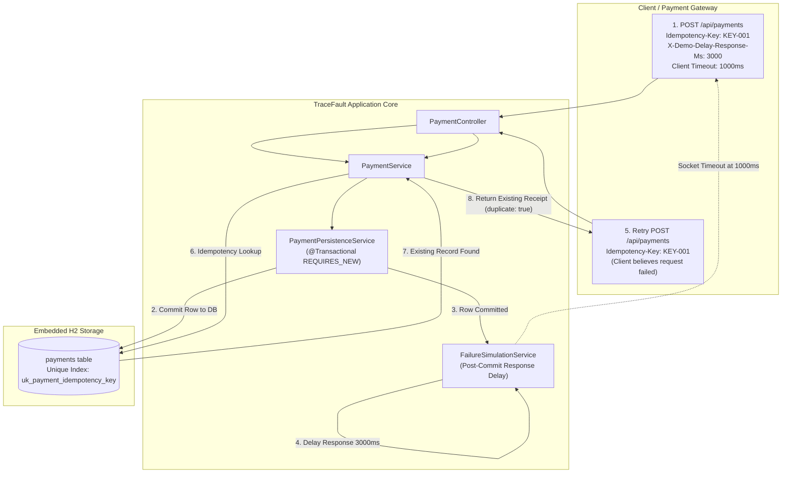

# TraceFault — Duplicate Payment Detection, Idempotency & Fault Recovery in Spring Boot

[]()
[]()
[]()
[-success.svg)]()
[]()
[]()
[]()

> A production-grade Spring Boot 3 reference prototype demonstrating distributed systems reliability, idempotency key patterns, network timeout retry failures, and two-tier concurrency recovery.

---

## Table of Contents

- [Overview & The Distributed Systems Dilemma](#overview--the-distributed-systems-dilemma)
- [Key Features](#key-features)
- [System Architecture & Two-Tier Defense](#system-architecture--two-tier-defense)
- [Technology Stack](#technology-stack)
- [Getting Started & Installation](#getting-started--installation)
- [Interactive Swagger OpenAPI Documentation](#interactive-swagger-openapi-documentation)
- [REST API Reference](#rest-api-reference)
- [Reproducing the Vulnerability (Before Fix)](#reproducing-the-vulnerability-before-fix)
- [Verifying Idempotency Protection (After Fix)](#verifying-idempotency-protection-after-fix)
- [Automated Integration Test Suite](#automated-integration-test-suite)
- [Wireshark Network Packet Forensics](#wireshark-network-packet-forensics)
- [Frequently Asked Questions (FAQ)](#frequently-asked-questions-faq)
- [Keywords & Technical Concepts](#keywords--technical-concepts)
- [Reliability Documentation Index](#reliability-documentation-index)

---

## Overview & The Distributed Systems Dilemma

In distributed payment architectures, network boundaries are inherently unreliable. When a client initiates a financial transaction:

1. The payment service processes and commits the transaction to the database.
2. Network latency or an intermediary gateway delay prevents the HTTP 200 response from reaching the client before its socket timeout expires.
3. The client assumes the request failed and automatically executes a retry.
4. Without strict idempotency handling, the payment service processes the repeated request as a separate charge, producing a critical duplicate payment incident.

TraceFault reproduces this exact scenario in a deterministic, observable environment using a post-commit response delay mechanism and proves how to eliminate duplicate payments using an enterprise-grade two-tier idempotency architecture.

---

## Key Features

- Idempotency Key Pattern: Full compliance with standard `Idempotency-Key` HTTP header semantics.
- Post-Commit Failure Simulation: Injects controlled server delays (`X-Demo-Delay-Response-Ms`) specifically after transactional database persistence to reproduce real-world lost responses.
- Two-Tier Concurrency Protection: Combines in-memory application-level lookup with database-level unique constraints (`uk_payment_idempotency_key`) to eliminate race conditions under high concurrency.
- Payload Tampering Detection: Automatically triggers HTTP 409 Conflict if an existing idempotency key is replayed with mismatched amounts, orders, or currencies.
- Dynamic Runtime Mode Switching: Seamlessly toggle between vulnerable mode (`tracefault.idempotency.enabled=false`) and protected mode (`tracefault.idempotency.enabled=true`) via REST API without restart.
- Interactive Swagger OpenAPI 3.0: Comprehensive endpoint documentation, schema definitions, and live execution via Swagger UI.
- Forensic Packet Analysis: Local HTTP loopback architecture designed for live Wireshark packet capture inspection.
- Zero External Infrastructure: 100% self-contained using Java 21, Spring Boot 3.5, and embedded H2 database.

---

## System Architecture & Two-Tier Defense



### Component Architecture

| Component | Class | Responsibility |
| :--- | :--- | :--- |
| Payment Controller | `PaymentController` | REST API endpoints for payment submission, receipt lookups, and financial auditing metrics. |
| Demo Controller | `DemoController` | Demonstration control endpoints for database reset and dynamic idempotency mode switching. |
| Payment Service | `PaymentService` | Business orchestration, idempotency checking, payload verification, and duplicate response caching. |
| Persistence Service | `PaymentPersistenceService` | Explicit transactional boundary (`@Transactional(propagation = Propagation.REQUIRES_NEW)`) ensuring database commit precedes response delays. |
| Failure Simulator | `FailureSimulationService` | Injects deterministic post-commit HTTP response delays based on request headers. |
| Schema Manager | `DatabaseIndexManager` | Programmatically adds or removes database unique index constraints based on active runtime mode. |
| Exception Handler | `GlobalExceptionHandler` | Translates exceptions to standardized RFC 7807 error responses (HTTP 400, 404, 409). |
| OpenAPI Config | `OpenApiConfig` | OpenAPI 3.0 specification metadata, tags, and documentation descriptors. |

---

## Technology Stack

- Language: Java 21 LTS (tested on Java 21 to Java 25)
- Framework: Spring Boot 3.5.x
- Data Access: Spring Data JPA & Hibernate 6.6
- Database: Embedded H2 In-Memory Database
- Documentation: SpringDoc OpenAPI 2.8.5 with Swagger UI 5.x
- Build System: Maven Wrapper (`mvnw`, `mvnw.cmd`)
- Testing: JUnit 5, Spring Boot Test, Mockito, AssertJ

---

## Getting Started & Installation

### Prerequisites
- JDK 21 or newer installed (`java -version`)
- Git

### Build Application
Clone the repository and build the standalone runnable JAR:

Windows PowerShell:
```powershell
.\mvnw.cmd clean package -DskipTests
```

macOS / Linux:
```bash
./mvnw clean package -DskipTests
```

### Launch Application
Windows PowerShell:
```powershell
.\mvnw.cmd spring-boot:run
```

macOS / Linux:
```bash
./mvnw spring-boot:run
```

---

## Interactive Swagger OpenAPI Documentation

Once the application is running, access the interactive API documentation directly in your browser:

- Swagger UI: [http://localhost:8080/swagger-ui/index.html](http://localhost:8080/swagger-ui/index.html)
- Raw OpenAPI 3.0 JSON Spec: [http://localhost:8080/v3/api-docs](http://localhost:8080/v3/api-docs)
- H2 Database Web Console: [http://localhost:8080/h2-console](http://localhost:8080/h2-console) (JDBC URL: `jdbc:h2:mem:tracefaultdb`, Username: `sa`, Password: *empty*)

---

## REST API Reference

### 1. Process Payment
`POST /api/payments`

Headers:
- `Content-Type: application/json`
- `Idempotency-Key: <string>` (Required in protected mode)
- `X-Demo-Delay-Response-Ms: <integer>` (Optional delay simulation)

Request Body:
```json
{
  "orderId": "ORDER-101",
  "amount": 1000.00,
  "currency": "INR"
}
```

Success Response (200 OK):
```json
{
  "id": 1,
  "orderId": "ORDER-101",
  "amount": 1000.00,
  "currency": "INR",
  "idempotencyKey": "KEY-DEMO-001",
  "paymentStatus": "SUCCESS",
  "createdAt": "2026-10-31T12:00:00.000Z",
  "updatedAt": "2026-10-31T12:00:00.000Z",
  "duplicate": false
}
```

### 2. Retrieve All Payments
`GET /api/payments`  
Returns a JSON array of all persisted payment entities.

### 3. Retrieve Payment by Idempotency Key
`GET /api/payments/by-key/{key}`  
Returns the payment transaction corresponding to the provided idempotency key (HTTP 404 if absent).

### 4. Financial Audit Statistics
`GET /api/payments/statistics`  
Returns real-time totals:
```json
{
  "totalRecords": 1,
  "successfulPayments": 1,
  "totalProcessedAmount": 1000.00
}
```

### 5. Reset Demonstration State
`POST /api/demo/reset`  
Clears synthetic payment rows and aligns database index constraints for clean demonstration runs.

### 6. Toggle Idempotency Mode
`POST /api/demo/mode?idempotencyEnabled=true|false`  
Switches protection mode dynamically without restarting the JVM.

---

## Reproducing the Vulnerability (Before Fix)

In vulnerable mode (`tracefault.idempotency.enabled=false`), duplicate request protection is disabled.

### Step 1: Reset Database
```powershell
curl.exe -s -X POST http://localhost:8080/api/demo/reset
```

### Step 2: Send Payment with 3-Second Post-Commit Delay (1-Second Client Timeout)
```powershell
curl.exe --max-time 1 -s -X POST http://localhost:8080/api/payments `
  -H "Content-Type: application/json" `
  -H "Idempotency-Key: KEY-DEMO-001" `
  -H "X-Demo-Delay-Response-Ms: 3000" `
  -d '{"orderId":"ORDER-101","amount":1000.00,"currency":"INR"}'
```
*Client times out after 1 second. Server logs confirm the payment committed successfully to H2 before delaying response.*

### Step 3: Wait 3 Seconds, Then Resend Identical Retry
```powershell
curl.exe -s -X POST http://localhost:8080/api/payments `
  -H "Content-Type: application/json" `
  -H "Idempotency-Key: KEY-DEMO-001" `
  -d '{"orderId":"ORDER-101","amount":1000.00,"currency":"INR"}'
```

### Step 4: Inspect Duplicate Payments
```powershell
curl.exe -s http://localhost:8080/api/payments/statistics
```
Result:
```json
{"totalRecords":2,"successfulPayments":2,"totalProcessedAmount":2000.00}
```
Two distinct payment rows were created for one intended order. The customer was charged twice.

---

## Verifying Idempotency Protection (After Fix)

### Step 5: Enable Idempotency Protection
```powershell
curl.exe -s -X POST "http://localhost:8080/api/demo/mode?idempotencyEnabled=true"
curl.exe -s -X POST http://localhost:8080/api/demo/reset
```

### Step 6: Repeat the Exact Same Experiment
```powershell
curl.exe --max-time 1 -s -X POST http://localhost:8080/api/payments `
  -H "Content-Type: application/json" `
  -H "Idempotency-Key: KEY-DEMO-002" `
  -H "X-Demo-Delay-Response-Ms: 3000" `
  -d '{"orderId":"ORDER-102","amount":1500.00,"currency":"INR"}'
```
Wait 3 seconds, then resend retry:
```powershell
curl.exe -s -X POST http://localhost:8080/api/payments `
  -H "Content-Type: application/json" `
  -H "Idempotency-Key: KEY-DEMO-002" `
  -d '{"orderId":"ORDER-102","amount":1500.00,"currency":"INR"}'
```
Response:
```json
{
  "id": 1,
  "orderId": "ORDER-102",
  "amount": 1500.00,
  "currency": "INR",
  "idempotencyKey": "KEY-DEMO-002",
  "paymentStatus": "SUCCESS",
  "duplicate": true
}
```

### Step 7: Verify Database Consistency
```powershell
curl.exe -s http://localhost:8080/api/payments/statistics
```
Result:
```json
{"totalRecords":1,"successfulPayments":1,"totalProcessedAmount":1500.00}
```
Exactly 1 record exists. Deduplication is proven.

### Step 8: Verify Payload Tampering Protection (HTTP 409)
```powershell
curl.exe -s -X POST http://localhost:8080/api/payments `
  -H "Content-Type: application/json" `
  -H "Idempotency-Key: KEY-DEMO-002" `
  -d '{"orderId":"ORDER-TAMPERED","amount":9999.00,"currency":"INR"}'
```
Response: HTTP 409 Conflict
```json
{
  "status": 409,
  "error": "Conflict",
  "message": "Idempotency key 'KEY-DEMO-002' was already used for a different payment payload. Existing: [orderId=ORDER-102, amount=1500.00 INR], Requested: [orderId=ORDER-TAMPERED, amount=9999.00 INR]"
}
```

---

## Automated Integration Test Suite

Execute the complete automated test suite covering all reliability criteria:

Windows PowerShell:
```powershell
.\mvnw.cmd test
```

macOS / Linux:
```bash
./mvnw test
```

### Test Coverage Matrix

| Scenario | Objective | Verification |
| :--- | :--- | :--- |
| `testNormalPayment` | Baseline payment | 1 payment committed, 200 OK |
| `testDuplicatePaymentBeforeCorrection` | Reproduce failure | 2 records created with matching idempotency key |
| `testDuplicatePaymentAfterCorrection` | Verify recovery | 1 record kept, `duplicate: true`, count unchanged |
| `testDifferentPaymentIdentifiers` | Distinct operations | Separate keys yield distinct records |
| `testPayloadMismatch` | Anti-tampering | HTTP 409 Conflict on payload variation |
| `testConcurrentDuplicateRequests` | Race condition defense | 10 concurrent threads result in exactly 1 record |
| `testStatisticsVerification` | Audit accuracy | Statistical counts match database entities |
| `testMissingIdempotencyKey` | Input validation | HTTP 400 Bad Request when header missing |
| `testQueryByKeyNotFound` | Transaction lookup | HTTP 404 for nonexistent key |
| `testDemoReset` | Demonstration reset | Synthetic records cleared and index rebuilt |
| `testPostCommitFailureTiming` | Persistence boundary | Confirms DB row is committed before delay completes |

---

## Wireshark Network Packet Forensics

TraceFault runs over local HTTP so packet analyzers like Wireshark can capture loopback traffic:

1. Launch Wireshark and select loopback adapter (`Npcap Loopback Adapter` on Windows, `lo0` on macOS/Linux).
2. Set display filter:
   ```
   tcp.port == 8080 && http
   ```
3. Run the reproduction curl script.
4. Observe the network signature:
   - Packet 1: HTTP POST `/api/payments` arriving from client.
   - Packet 2: TCP FIN/RST packet emitted by client when 1000ms timeout expires.
   - Packet 3: Delayed HTTP 200 OK response sent by server 3000ms later.
   - Packet 4: Second HTTP POST `/api/payments` retry sent by client.
5. Contrast Wire Evidence with Database Evidence: The wire showed a timeout error, but the database shows the original payment committed. This discrepancy illustrates why client-side state alone cannot guarantee distributed transaction safety.

---

## Frequently Asked Questions (FAQ)

### What is an Idempotency Key and how does it prevent duplicate charges?
An idempotency key is a unique token generated by the client (such as a UUID) and passed in an HTTP header (`Idempotency-Key`). The payment service checks whether an operation with that key has already been executed. If found, the server safely returns the previously saved receipt without reprocessing the financial transaction.

### Why do client retries cause duplicate payments after timeouts?
In HTTP/TCP networks, a timeout only means the client stopped waiting for an answer. It does not indicate that the server failed. If the server committed the transaction to the database before the delay occurred, any subsequent client retry without an idempotency check will be processed as an entirely new transaction.

### What is the two-tier defense pattern for idempotency?
Relying solely on an application-level cache or database query creates a race condition when concurrent requests arrive simultaneously. The two-tier pattern combines:
1. Application lookup: Quickly returns cached receipts for sequential retries.
2. Database-level unique constraint: Serves as an unbreachable barrier that forces the database engine to reject concurrent duplicate inserts with a constraint violation.

### How does TraceFault detect payload tampering?
If a malicious or erroneous client reuses an idempotency key with different order details (such as a different `orderId` or `amount`), TraceFault compares the requested payload against the original transaction and immediately responds with HTTP 409 Conflict.

---

## Keywords & Technical Concepts

Distributed Systems • Spring Boot 3 • Java 21 • Idempotency Key Pattern • Duplicate Payment Processing • Payment Gateway Reliability • Network Timeout Simulation • At-Least-Once Delivery Semantics • Two-Tier Concurrency Protection • RFC 7807 Problem Details • H2 Database • Spring Data JPA • Wireshark Packet Forensics • Swagger OpenAPI 3.0 • Software Reliability Engineering (SRE)

---

## Reliability Documentation Index

- [docs/architecture.md](docs/architecture.md): Deep dive into transaction boundaries, sequence diagrams, and failure flows.
- [docs/investigation-report.md](docs/investigation-report.md): Full reliability forensic report with network vs database evidence analysis.
