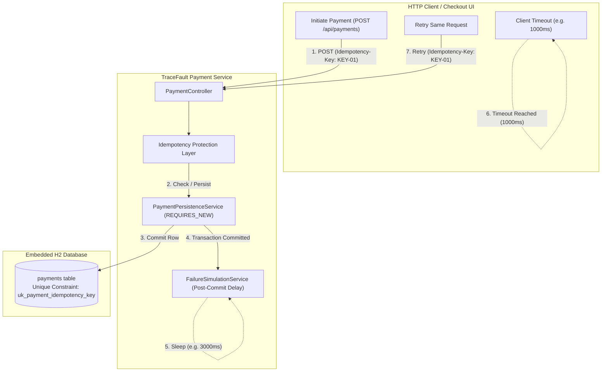
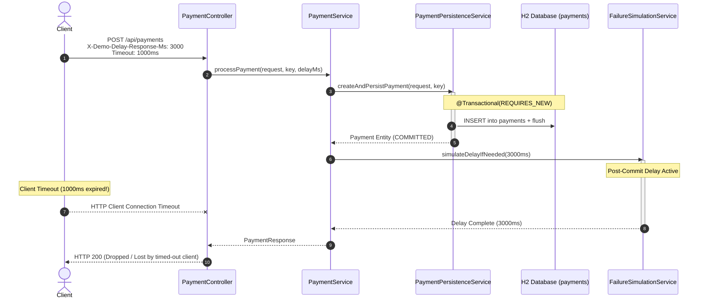
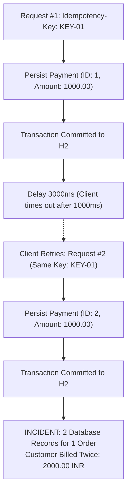
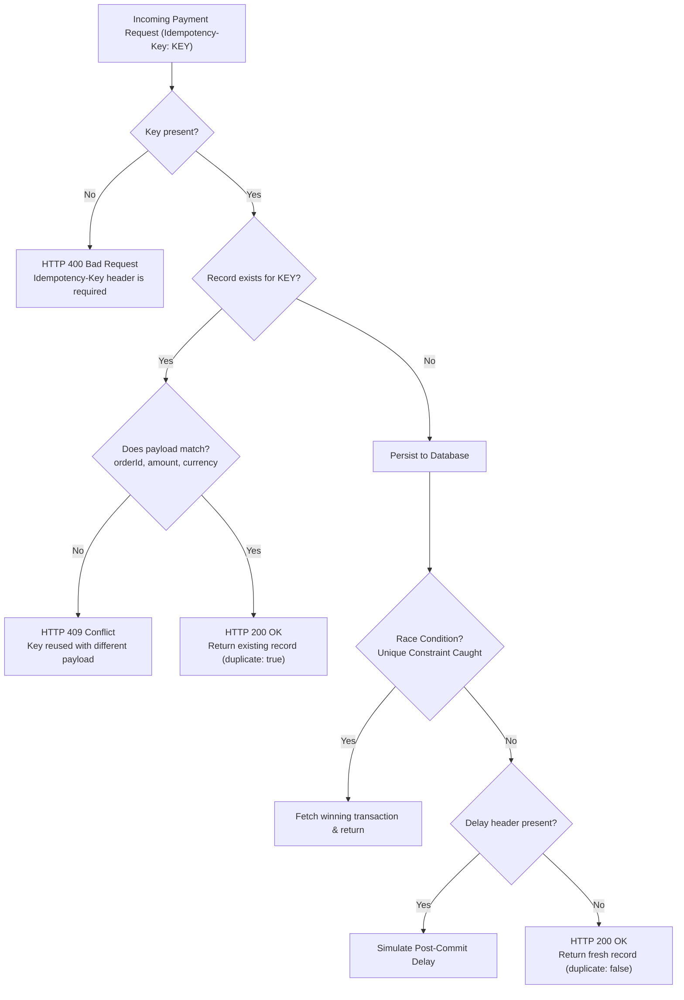

# TraceFault — Architecture & Reliability Design

## 1. System Overview

**TraceFault** is an engineering prototype designed to reproduce, investigate, correct, and verify a classic distributed system reliability failure: **duplicate transaction processing caused by post-commit response loss followed by a client retry**.

In distributed payment workflows, network boundaries separate the payment consumer (client/checkout service) and the payment processor (server). When a server completes business logic and commits state to a database, any subsequent network degradation, firewall drop, or server delay before the HTTP response reaches the client results in a **client-side timeout**. Because the client cannot distinguish between a server failure *before* processing and a response failure *after* processing, it retries the request, leading to duplicate debits if idempotency is absent.



---

## 2. Layered Component Architecture

TraceFault follows clean architectural separation of concerns:

```
com.tracefault/
├── config/
│   ├── TraceFaultProperties.java     # Configuration binding (tracefault.idempotency.enabled)
│   └── DatabaseIndexManager.java     # Synchronizes H2 unique index with active mode
├── controller/
│   ├── PaymentController.java        # REST endpoints for payment submission, list, stats
│   └── DemoController.java           # Demo reset, mode toggling (!prod profile only)
├── dto/
│   ├── PaymentRequest.java           # Inbound payload validation (Jakarta Validation)
│   ├── PaymentResponse.java          # Outbound representation with duplicate flag
│   ├── PaymentStatisticsResponse.java# Aggregated transaction metrics
│   └── ErrorResponse.java            # Standardized RFC 7807-inspired error payload
├── entity/
│   ├── Payment.java                  # JPA Entity (payments table)
│   └── PaymentStatus.java            # Transaction status enum (SUCCESS, PENDING, FAILED)
├── exception/
│   ├── GlobalExceptionHandler.java   # Centralized RestControllerAdvice
│   ├── PaymentConflictException.java # HTTP 409 for payload mismatches
│   ├── MissingIdempotencyKeyException.java # HTTP 400 for omitted keys
│   └── PaymentNotFoundException.java # HTTP 404 for missing records
├── repository/
│   └── PaymentRepository.java        # Spring Data JPA repository with aggregation queries
└── service/
    ├── PaymentService.java           # Orchestrator: Idempotency enforcement & business logic
    ├── PaymentPersistenceService.java# Dedicated transactional boundary (REQUIRES_NEW)
    └── FailureSimulationService.java # Post-commit delay injection
```

---

## 3. Transaction Boundary & Controlled Failure Injection

A critical requirement of reproducing this distributed failure is ensuring that:
1. The payment record is **fully committed** to the database.
2. The delay or failure occurs **after** commit, not before.

If `Thread.sleep()` were executed inside a `@Transactional` boundary, the database transaction would remain uncommitted during the delay, and any connection drop would trigger a rollback.

TraceFault solves this cleanly by decoupling transaction persistence from response generation:



---

## 4. Before-Fix Flow: Vulnerable Mode (`tracefault.idempotency.enabled=false`)

In vulnerable mode:
1. No unique database index exists on `idempotency_key`.
2. The service performs no idempotency lookup.
3. Every incoming request executes `PaymentPersistenceService.createAndPersistPayment()`.
4. When the client times out on request #1 and retries as request #2, **two distinct payment records** are persisted for one customer order.
5. Total processed amount doubles.



---

## 5. After-Fix Flow: Corrected Mode (`tracefault.idempotency.enabled=true`)

The corrected architecture implements a **two-tier idempotency defense**:

1. **Application-Level Tier (Read & Match)**:
   - Queries `paymentRepository.findByIdempotencyKey(key)`.
   - If an existing payment is found:
     - **Payload Validation**: Verifies `orderId`, `amount`, and `currency` match the original transaction.
     - If payload matches: Returns existing payment response immediately with flag `duplicate: true`.
     - If payload differs: Rejects with **HTTP 409 Conflict** (`PaymentConflictException`).

2. **Database-Level Tier (Unique Index & Concurrency Defense)**:
   - A unique constraint `uk_payment_idempotency_key` is enforced on table `payments (idempotency_key)`.
   - If two identical requests race concurrently across worker threads:
     - The first thread acquires the insert lock and commits.
     - The second thread receives `DataIntegrityViolationException`.
     - `PaymentService` catches this violation, re-queries the committed transaction, verifies payload match, and returns the existing record.


